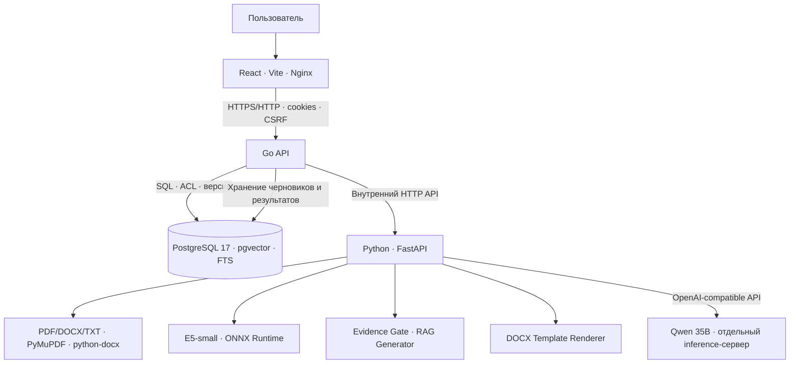

# Помощник по внутренним документам

**AI Document Assistant** — веб-приложение для поиска информации во внутренних регламентах и подготовки проектов документов по утверждённым шаблонам.

Разработано командой **ionos_team** для хакатона по кейсу Банка России «Интеллектуальный помощник по работе с внутренними регламентами и документами».

Приложение объединяет **поиск по смыслу с проверяемыми источниками**, **диалог с AI**, **управление доступом** и **формирование DOCX**. Пользователь может выбрать шаблон в мастере или попросить ассистента подготовить документ прямо в чате.

> **Назначение:** демонстрационный прототип корпоративного помощника. Сформированные DOCX — **проекты** документов, а не подписанные, зарегистрированные или юридически согласованные акты. Ответы AI следует сверять с первоисточниками.

## Возможности

| Функция | Что умеет система |
| --- | --- |
| **База знаний** | Загрузка PDF, DOCX и TXT; извлечение текста, разбиение на фрагменты, индексация и версионность |
| **AI-поиск** | Семантический поиск через multilingual E5 и pgvector, полнотекстовый поиск PostgreSQL, проверка достаточности найденных фрагментов |
| **Ответы с источниками** | Русскоязычные ответы Qwen со ссылками на документ, версию, фрагмент и, где доступны, пункт или страницу |
| **Работа с неизвестным** | Если доступные документы не подтверждают утверждение, ассистент может сообщить о нехватке сведений, не выдумывая ответ |
| **История диалогов** | Сохранённые чаты, продолжение беседы и разграничение доступа к сообщениям |
| **Генерация DOCX через мастер** | Выбор зарегистрированного модуля, пошаговое заполнение, условные и повторяемые поля, проверка и скачивание |
| **Генерация DOCX через чат** | Запрос естественным языком → выбор доступного шаблона → вопросы по полям → проверка → подтверждение → DOCX |
| **Безопасность** | Аутентификация, роли, CSRF, ACL на документы, проверка источников и защита связанных результатов при отзыве доступа |

### Два способа подготовить документ

**Через раздел «Шаблоны»** — пользователь выбирает модуль, заполняет интерактивную форму и получает проект DOCX.

**Через чат** — пользователь пишет, например:

> Мне необходимо подготовить распоряжение о создании рабочей группы. Помоги оформить документ.

Ассистент выбирает **доступный зарегистрированный шаблон**, задаёт вопросы из его актуального профиля, сохраняет настоящий черновик и после проверки и подтверждения позволяет скачать Word-файл. Черновик можно открыть в обычном мастере и продолжить редактирование там.

Обычные информационные вопросы **не должны автоматически создавать документы**. Во время заполнения можно задать вопрос по регламенту и затем вернуться к черновику. Интерпретация свободного текста выполняется LLM и может требовать уточнения или ручного исправления поля.

## Архитектура



**Основные сервисы Docker Compose:**

- `frontend` — пользовательский интерфейс на React, сборка Vite, раздача через Nginx.
- `api` — Go: HTTP API, авторизация, права доступа, поиск, история диалогов, управление шаблонами и черновиками.
- `ai-service` — Python/FastAPI: парсинг документов, embeddings E5, Evidence Gate, взаимодействие с Qwen и рендеринг DOCX.
- `postgres` — PostgreSQL 17 с pgvector, полнотекстовыми индексами и данными приложения.

Qwen работает **на отдельном разрешённом inference-сервере** и вызывается через OpenAI-совместимый API. **Модель не подключается к PostgreSQL напрямую**: выбор и проверка доступных источников выполняются приложением.

### Как формируется ответ

1. Пользователь задаёт вопрос в чате.
2. Go ограничивает область поиска документами и версиями, доступными пользователю.
3. PostgreSQL FTS и E5/pgvector находят кандидатов по тексту и смыслу.
4. Evidence Gate отбирает фрагменты, подтверждающие ответ.
5. Qwen составляет ответ на основе переданных доказательств.
6. Go проверяет ссылки на реальные источники и сохраняет результат с учётом прав доступа.

Наличие цитаты **не гарантирует безошибочную интерпретацию**: особенно внимательно следует проверять таблицы, исключения, отрицания и сочетание нескольких условий.

## Стек программного продукта


| Слой | Технологии |
| --- | --- |
| Интерфейс | React, TypeScript, Vite, CSS, Nginx |
| Основной backend | Go, REST API, Goose, Argon2id |
| AI-сервис | Python, FastAPI, httpx |
| LLM | Qwen `qwen3.6-35b-a3b` через OpenAI-совместимый API |
| Embeddings | `intfloat/multilingual-e5-small`, ONNX Runtime, 384 измерения |
| Поиск и хранение | PostgreSQL 17, pgvector, Russian FTS |
| Документы | PyMuPDF, python-docx, собственный движок DOCX-модулей |
| Развёртывание | Docker, Docker Compose |

## Быстрый запуск

### Требования

- Windows 10/11 с PowerShell и Docker Desktop (либо совместимое окружение с Docker Compose).
- Доступ к настроенному серверу Qwen с OpenAI-совместимым API.
- Достаточно памяти и дискового пространства для PostgreSQL, Python и локальной модели embeddings.
- Настроенные значения окружения, включая пароли БД, ключ сервисного взаимодействия и параметры администратора.

### 1. Конфигурация

Рабочий каталог проекта:

```powershell
cd D:\Projects\hackathon
```

Создайте локальный `.env`, ориентируясь на **актуальные** параметры из `.env.example` и `docker-compose.yml`. Перед использованием и публикацией убедитесь, что пример конфигурации не содержит действующих секретов. Не коммитьте `.env` и реальные ключи.

Проверьте как минимум:

- подключение к PostgreSQL и параметры первого администратора;
- `AI_SERVICE_URL` и внутренний токен между Go и Python;
- `LLM_*` — адрес OpenAI-совместимого сервера Qwen, модель и авторизацию;
- `RAG_ENABLED=true`;
- `SEMANTIC_SEARCH_ENABLED=true`;
- при необходимости `CHAT_DOCUMENT_CREATION_ENABLED=true` для создания DOCX через чат;
- `POSTGRES_DATA_VOLUME` — **действующий том PostgreSQL**; его имя важно сохранять между обновлениями.

Точные имена остальных переменных берите из текущей конфигурации репозитория. Значения `.env` попадают в контейнер только тогда, когда их передаёт Compose.

```powershell
docker compose config --quiet

# Убедиться, какое значение будет передано в Go API:
$cfg = docker compose config --format json | ConvertFrom-Json
$cfg.services.api.environment.CHAT_DOCUMENT_CREATION_ENABLED
```

### 2. Собрать образы и подготовить embeddings

```powershell
docker compose build

# Один раз для нового/пустого тома embeddings; модель хранится отдельно от образа:
docker compose run --rm --no-deps --user root ai-service python -m scripts.download_embeddings
```

Проверяемая локальная модель: `intfloat/multilingual-e5-small` (ONNX). Если кэш модели отсутствует, векторный сервис может возвращать ошибку, а поиск — переходить на полнотекстовый fallback.

### 3. Проверить и применить миграции

**Для новой БД** или при обновлении существующей базы сначала обеспечьте запуск PostgreSQL:

```powershell
docker compose up -d postgres

docker compose run --rm --no-deps api migrate status
docker compose run --rm --no-deps api migrate up
docker compose run --rm --no-deps api migrate status
```

Перед применением миграций к **существующей** базе обязательно сделайте резервную копию и убедитесь, что используется правильный PostgreSQL volume. Миграции запускаются штатным Go/Goose-механизмом, а не вручную через `DELETE` или изменение таблиц.

Диалоговая генерация DOCX использует миграцию **`00013_chat_document_workflow.sql`**. При использовании новой сборки API схема должна быть совместима с ней. В проверенном пользовательском окружении миграция 13 уже была применена, но это **не гарантия состояния другой установки**.

### 4. Запустить приложение

```powershell
docker compose up -d

docker compose ps
```

Откройте **http://localhost:8080** и войдите с учётной записью, настроенной при первоначальном запуске.

Для обновления образов без удаления данных:

```powershell
docker compose up -d --build
```

> **Никогда не используйте `docker compose down -v` как обычный способ перезапуска.** Это может удалить тома с базой данных, документами и embeddings. Также не запускайте `docker volume prune` в рабочем окружении.

### 5. Включить подготовку DOCX через чат

Для работы функции необходимы:

1. Схема БД с миграцией 13.
2. Согласованно обновлённые `api`, `ai-service` и `frontend`.
3. Включённый `CHAT_DOCUMENT_CREATION_ENABLED=true` **внутри контейнера Go API**.
4. Доступные пользователю **зарегистрированные** DOCX-шаблоны.
5. Доступный Qwen-сервер с поддержкой используемого структурированного ответа.

После изменения `.env`/Compose пересоздайте Go API без удаления volumes:

```powershell
docker compose up -d --no-deps --force-recreate api

# Проверка без вывода всех переменных и секретов:
docker inspect $(docker compose ps -q api) `
  --format '{{range .Config.Env}}{{println .}}{{end}}' |
  Select-String 'CHAT_DOCUMENT_CREATION_ENABLED'
```

`CHAT_DOCUMENT_CREATION_ENABLED=true` в файле `.env` недостаточно, если фактическая конфигурация Compose по-прежнему передаёт `false`.

## Как пользоваться

### База знаний

Администратор загружает PDF/DOCX/TXT. После обработки документы со статусом готовности становятся доступны для поиска **только пользователям с соответствующими правами**. Загрузка DOCX в базу знаний **сама по себе не регистрирует его как шаблон генерации**.

### Помощник

Примеры запросов:

- «С какой даты вступает в силу учебная Инструкция по делопроизводству?»
- «Какие зоны модульного документа нужно сохранить при подготовке проекта?»
- «Расскажи о назначении матрицы обязательного визирования».
- «Какой денежный штраф установлен за ошибку в модульном документе?» — проверка поведения при отсутствии сведений.

Ответы должны проверяться по документам и показанным цитатам. Вопросы с условиями и таблицами могут выявлять ограничения retrieval и генерации.

### Шаблоны

Для генерации используются **зарегистрированные и проверенные профили v2**. Поддерживаются семь учебных модулей:

1. Создание рабочей группы.
2. Создание проектного комитета.
3. Проведение внутреннего аудита процессов.
4. Назначение ответственных за делопроизводство.
5. Приём и передача дел и имущества.
6. Утверждение и введение в действие локального документа.
7. Ввод информационной системы в эксплуатацию.

Конфигурации профилей находятся в `docs/template-profiles/v2/`. Для использования администратор загружает соответствующий оригинальный DOCX, регистрирует его с подходящим профилем и предоставляет необходимый доступ.

Мастер поддерживает обязательные, условные и повторяемые поля, версии черновиков, проверку заполнения, предупреждения и сведения о согласовании. Полученный DOCX не является подписанным документом.

### Генерация через чат

Введите: «Мне нужно подготовить распоряжение о создании рабочей группы. Помоги оформить его».

Если соответствующий шаблон зарегистрирован и доступен, ассистент начинает заполнять **тот же тип черновика**, который используется в мастере. Можно просмотреть прогресс, изменить ответ, открыть документ в разделе «Шаблоны», проверить его и скачать результат после подтверждения.

При разговоре с Qwen возможны ошибки извлечения нескольких реквизитов из одного сообщения; сверяйте заполненные значения перед генерацией. Для сложных полей предусмотрен обычный редактор формы.

## Безопасность и ограничения

- Авторизация на основе защищённой сессии; роли администратора и участника.
- CSRF/Origin-проверки и ограничение частоты для чувствительных операций.
- Доступ к документам и их активным версиям контролируется сервером и SQL.
- Отзыв доступа ограничивает просмотр исходных документов и производных сведений в чатах.
- Выбор шаблона, изменение черновика и скачивание DOCX повторно проверяются сервером.
- Ответы Qwen ограничены найденными доказательствами и валидацией источников, но **семантические ошибки и неполные ответы всё ещё возможны**.
- Не реализованы корпоративные электронная подпись, юридическое визирование в реальных подразделениях и автоматическая регистрация в сторонней системе документооборота.
- Образцы организаторов — **учебные документы**, а не действующие нормативные акты Банка России.

Функция `CONTEXT_RESOLVER_ENABLED` исследовалась отдельно; в ранее проверенной основной конфигурации была выключена. Не включайте экспериментальные режимы без отдельной проверки. Ранее отклонённые ветки Plain Language и Evidence Coverage были удалены при очистке репозитория.

## Структура репозитория

```text
.
├── cmd/server/                 # Точка входа Go API и команды миграций
├── internal/                   # Go domain/service/repository/HTTP/AI client
├── migrations/                 # Версионируемые SQL-миграции Goose
├── ai-service/                 # FastAPI, RAG, E5, обработка и рендеринг DOCX
├── frontend/                   # React-приложение
├── docs/                       # Архитектура, инструкции, профили и отчёты
│   └── template-profiles/v2/   # Семь конфигураций DOCX-модулей
├── scripts/                    # Служебные и интеграционные проверки
├── experiments/                # Сохраняемые исследовательские сценарии
├── docker-compose.yml
└── .env.example
```

## Проверки для разработчиков

Используйте реальные зависимости и настройки тестовой БД. Интеграционные тесты не должны подключаться к пользовательской PostgreSQL.

```powershell
# В корне репозитория — Go
go test ./...
go vet ./...

# AI service
cd ai-service
python -m pytest -q
cd ..

# Frontend
cd frontend
npm ci
npm run build
# Доступные команды проверки уточните через npm run
cd ..

# Проверка Compose
docker compose config --quiet
```

В проекте также есть тесты HTTP/SQL ACL, E5/pgvector, Qwen-интерпретации, DOCX v2 и браузерные E2E. Некоторые требуют отдельной PostgreSQL, ONNX-весов, разрешённого сервера Qwen или подготовленного тестового окружения.

## Демонстрационный сценарий

1. Открыть обновлённый русскоязычный интерфейс.
2. Показать загруженные инструкции и модули.
3. Задать вопрос по Инструкции → показать ответ и точную цитату.
4. Задать вопрос с отсутствующими сведениями → показать корректный отказ.
5. Перейти в «Шаблоны» → заполнить черновик → проверить → сгенерировать DOCX.
6. При подтверждённой готовности: показать создание DOCX по просьбе в чате.
7. Продемонстрировать роли и доступ к документам.

При записи ролика используйте **фактические ответы** приложения, не подменяйте их заранее написанным текстом. Наличие фрагмента с правильным ID не означает, что вся формулировка AI точна.

## Команда

**ionos_team** — разработка для хакатона по кейсу Банка России.

---

**AI Document Assistant** — от поиска по внутреннему регламенту до проверяемого ответа и проекта Word-документа.
