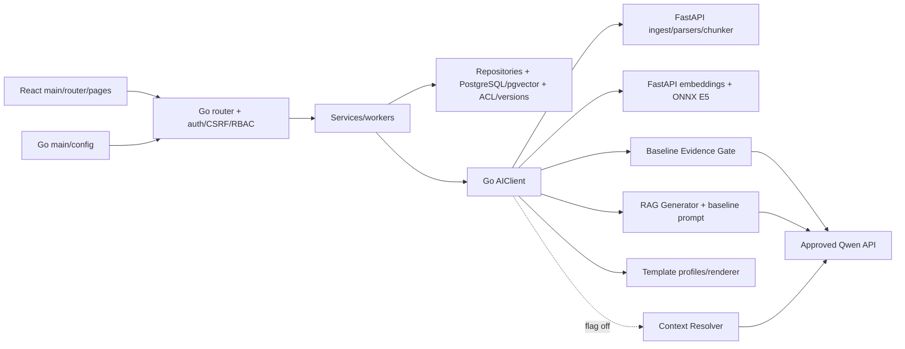

# Безопасная уборка репозитория

25 октября 2026 года, Europe/Moscow. Проект: `D:\Projects\hackathon`.

## A. Что найдено

Отклонённые Coverage 2.0 и Plain Language удалены вместе с интерфейсами,
конфигурацией и исследовательской обвязкой. Действующие Generator, Evidence Gate,
Semantic Search, DOCX Generator, frontend и Go runtime функционально сохранены.

Фактическая проверка до изменений:

- Основные четыре контейнера healthy; PostgreSQL — `pgvector/pgvector:pg17-bookworm`.
- Последняя запись Goose — `12|t`; вся история 1–12 сохранена.
- API: RAG и semantic search true, Context Resolver false.
- AI: `qwen3.6-35b-a3b`, Plain Language false; Coverage unset, default false.
- Действующие volumes: `hackathon_postgres_semantic_20261024`,
  `hackathon_documents_data`, `hackathon_embedding_models`; данные/mounts не менялись.
- Исходно 30 изменённых tracked-файлов, staged diff пуст. Проверены `git status`,
  unstaged/staged diff, полные tracked/untracked/ignored списки и `docker compose ps`.
  Не использовались reset/restore/stash/clean для всего дерева.
- Включён в аудит игнорируемый `ai-service/app/embeddings/coverage.py`: правило
  `coverage.*` скрывало настоящий импортируемый Python-модуль.
- `AGENTS.md` в проекте и родительских каталогах не обнаружен.

Накопленный объём — код нескольких отклонённых кандидатов, frozen baseline,
Go overlays, результаты инференса и повторные JSON-экспорты. Выключенный флаг
сам по себе не считался основанием удалить функцию.

Полная таблица **527 исходных путей**, включая категорию, использование,
доказательство, решение, confidence, LOC, bytes и SHA-256:
`D:\Projects\hackathon-cleanup-backup-20261025\inventory-audit.csv`.
Сырые manifests: `inventory-before.json`, `inventory-after.json` там же.

| Путь | Категория | Используется? | Доказательство | Решение |
|---|---|---|---|---|
| `cmd/server/` | Production/CLI | Да | `main -> run`, constructors/DI/workers; Docker ENTRYPOINT | Сохранить |
| `internal/transport/http/` | HTTP/security | Да | `NewRouter` регистрирует auth/users/docs/search/chat/templates; auth/CSRF/RBAC middleware | Сохранить |
| `internal/service/` | Production | Да | Main/handlers/workers, интерфейсы и SQL/HTTP tests | Сохранить |
| `internal/repository/postgres/` | SQL + tests | Да | Реализации service interfaces; ACL, active-ready и version filtering внутри SQL | Сохранить |
| `internal/aiclient/`, `domain/`, `config/`, `database/`, `logger/`, `queryunderstanding/` | Production | Да | Wire DTO, validation, DI и actual calls; test/vet/build | Сохранить |
| `internal/migrator/`, `migrations/` | Build/runtime/schema | Да | `//go:embed *.sql`, startup/CLI; основная схема 12 | Сохранить 1–12 |
| `document_storage_{windows,unix}.go` | Platform code | Да | Build constraints; Windows tests и Linux Docker build | Сохранить обе реализации |
| `ai-service/main.py`, `app/application.py` | Startup | Да | Uvicorn -> create_app -> lifespan/routers | Сохранить |
| `app/api/`, `ingestion/`, `chunking/` | Production/HTTP | Да | Go multipart ingest; PDF/DOCX/TXT parsers и chunking | Сохранить |
| `app/embeddings/{routes,model,onnx,schemas,evidence}.py` | Production/HTTP | Да | Go вызывает `/embeddings`, `/evidence`; реальные E5/Gate проверки | Сохранить baseline |
| `app/rag/{generator,prompts}.py`, `app/llm/client.py` | RAG | Да | `/rag/generate -> generate -> messages_for -> httpx -> Qwen` | Убрать только добавку стиля |
| Python `resolver.py`, Go `resolve.go`/`chat_context.go` | Отключённая функция продукта | Не включена в основном API | ChatService/AIClient -> private `/rag/resolve`, metrics/tests и миграция 12 | Сохранить |
| `app/embeddings/coverage.py` | Отклонённая ветка | Только при rejected flag | Единственный runtime-вход — conditional в `select_evidence`; явный отказ в задании | Архивировать/удалить |
| `frontend/src/` | React runtime + tests | Да | Main/router/pages, barrels/JSX/hooks/API; TS symbol audit, Vitest/ESLint/tsc/build | Сохранить |
| favicon, CSS, Vite/TS/ESLint/Tailwind, nginx | Assets/build/config | Да | HTML/CSS imports, scripts, production bundle и SPA/proxy | Сохранить |
| `app/templates/`, `docs/template-profiles/` | DOCX runtime/profiles | Да | Source-pinned профили, template_v2_cases, validation/renderer/HTTP | Сохранить побайтово |
| `data/`, `ai-service/examples/`, `docs/tasks/` | Оригиналы/примеры/требования | Да либо недостаточно доказательств обратного | Fingerprints/fixtures/демонстрация/организаторские документы | Сохранить |
| `*_test.go`, Python/frontend tests, `tests/integration/` | Regression/security | Да | Auth, ACL/provenance, source IDs, versions, ingestion, templates | Сохранить общие контракты |
| `experiments/context-dialogue/` без rejected v4 | Opt-in QA | Да | Go ContextEvaluation читает corpus.json; off/on runners, стабилизационные корпуса | Сохранить; убрать retired modes |
| `experiments/evidence-coverage/` | Rejected research | Только старый эксперимент | Не входит в Docker/runtime; зависит от removed Coverage | Архивировать/удалить |
| Pair evaluator, completeness runner/v4 corpora/patch | Rejected research | Только старое сравнение | Frozen candidate; default context QA не зависит | Архивировать/удалить |
| `experiments/rag/`, `semantic-pilot/`, `semantic-main/` | Research/QA | Да, вручную | Main/pilot импортируют rag/benchmark.py и embedding.py | Сохранить runners/корпуса |
| `experiments/{rag,semantic-pilot}/results/` | Frozen outputs | Runtime не читает | Export из local artifacts; сохранённый CLI пишет, review читает явно выбранную папку | Архивировать JSON |
| `scripts/`, сохраняемые `ai-service/scripts/` | QA/build/manual | Да/opt-in | Demo/profile/download/regression tools; documented manual consumers | Сохранить |
| Dockerfiles/Compose/env examples/requirements/Go modules/lockfiles | Config/build | Да | COPY/CMD/healthchecks/mounts/config readers/package scripts | Убрать два flags и SDK |
| `.github/`, `api/`, `.gitkeep` | Scaffold | Нет исполняемой функции | Пустые placeholders; выигрыш от удаления отсутствует | Сохранить |
| `.local-integration/` | Смешанные локальные данные | Частично | Отдельно исследованы venv/model/backups/docs/results; production mounts сверены | Только проверенные удаления |
| `.env`, private config, uploads/generated DOCX, backups | Secrets/data | Да/неясно | Действующая среда или уникальные данные | Не трогать |
| Venv/node_modules/cache/tmp | Dependencies/generated | Да/неясно | Не source LOC; sizes отдельно ниже | Автоматически не чистить |

Граф поддерживаемых вызовов:

Проверены interfaces/constructors/workers/embed/build constraints, dynamic imports,
FastAPI decorators/models/startup, React routes/barrels/conditional admin UI,
Docker COPY/CMD/healthchecks/mounts. Endpoint без прямого Python call site не удалялся.

## B. Что удалено

**A — rejected AI:** `coverage.py` (`COVERAGE_PROMPT`, `Aspect`, `CoverageResponse`,
`validate_coverage`, `select_coverage`), conditional/import в `select_evidence`,
`PLAIN_LANGUAGE_INSTRUCTIONS`, keyword override/env-read в `messages_for`;
`EVIDENCE_COVERAGE_ENABLED` и `RAG_PLAIN_LANGUAGE_ENABLED` из Compose и
`.env.example`. Базовая `validate_evidence`, source IDs,
безопасные labels ошибок и исходный `SYSTEM_PROMPT` сохранены.

Удалены `test_evidence_coverage.py` и `test_rag_style.py`. Из 27 случаев четыре
общих контракта перенесены в `test_multi_evidence.py`: исходные данные/один вызов,
upstream failure, cancellation, HTTP auth/wire. Другие общие проверки цитат,
неизвестных/повторных UUID, отказов и безопасного логирования сохранены.

**B — research:** evidence-coverage scripts/corpus, pair evaluator, completeness
runner/v4 corpora/rejected patch, три каталога historical JSON outputs, 266
локальных файлов rejected Coverage/Plain/Completeness/style. У сохранённых
context runners/Go evaluator удалены только retired modes. Точные пути — в приложении.

**C/D — Go/React:** дополнительных HIGH CONFIDENCE удалений нет. Поиск одиночных
объявлений, TS symbol references, import/DI и маршруты не доказали ненужность
других поддерживаемых компонентов. Одиночные Python endpoint definitions
зарегистрированы routers и используются по HTTP; сохранены.

**E — dependency/config:** удалён только unused `openai` из Python requirements.
Реальный LLMClient использует явно объявленный `httpx`. Новый образ без SDK
прошёл startup/full suite. Dotenv нужен scripts, huggingface-hub — provision,
остальные Go/frontend зависимости имеют runtime/build/test consumers.
`go mod tidy -diff` пуст; версии и lockfiles не менялись.

**F — docs:** три rejected отчёта архивированы; обновлены rag.md, два context
отчёта, semantic verification, три experiment README/report. Внутренние ссылки
на удалённые outputs заменены сведениями об архиве. Сохранены исторические выводы
и ограничения. В rag.md исправлены устаревшие сведения об отсутствующем Python
endpoint, Compose default и миграционной истории.

## C. Почему удалено

HIGH CONFIDENCE основан на явном отклонении кандидатов в задании, найденных
единственных flagged входах, отсутствии зависимости поддерживаемых entrypoints,
проверке consumers/tests и восстановлении первоначальных рабочих байтов по SHA-256.
Для historical JSON подтверждены происхождение из export и отсутствие runtime
input dependency. Export по-прежнему может создать новую локальную копию;
для проверки старого manual review сначала нужен внешний архив.

Исторические результаты Coverage: 18/23 против 17/23 при Resolver OFF, 19/23
против 17/23 при ON, задержка и validation failures. Это основание отказа из
задания/старого исследования, а не новый quality benchmark этой уборки.

В `compatibility.log` код из source-before.zip сравнен с новым образом при
исходных OFF flags: Generator prompt и messages полностью одинаковы; Gate
messages, результаты и errors совпадают для empty/valid evidence, invalid JSON
и invented quote. Количество Qwen calls не увеличилось. SHA-256 SYSTEM_PROMPT:
`13b029fa63740ff4072f06863134a77829fbfed892e1a88453d79fe42a189060`.

## D. Что оставлено

**Context Resolver — решение A: нужная функция продукта, выключенная до стабилизации.**
Сохранены private endpoint/metrics, strict schemas/anchors, Go AIClient,
ChatService/search integration, flag/timeout, persisted `starts_new_topic`,
миграция `00012_chat_context_topic.sql`, корпуса и relevant tests. Флаг не включался.

Сохранены auth/Argon2id/cookies/CSRF/RBAC, ACL SQL и redaction транзитивных chat
зависимостей, active-ready/version filtering, parsers, retries/workers,
idempotency, semantic fallback, source admission, DOCX Generator и OpenAPI.
Все семь v2 profiles/оригиналы и исходные изменения Users/админского UI сохранены
побайтово, как и миграционная история.

Manifest проверен: каждый исходный существующий файл вне **17 целевых правок**
и **61 явно архивированного проектного удаления** неизменен побайтово: 449 файлов.
Staged diff остался пуст. Исходные незакоммиченные изменения не заменялись HEAD.

## E. Архив и восстановление

Внешний каталог: `D:\Projects\hackathon-cleanup-backup-20261025`.

- `source-before.zip`: 1,152,316 bytes; SHA-256 `e56369aa3c8a258bff8c64c8200282e5d8e9d5b9d6285ab858509305d8ee95f2`.
- `retired-research.zip`: 944,252 bytes; SHA-256 `21979c76d4eb613a5325d8c1f034e93352b9cf5089d41e03d63adb738cc7ae31`.

Source archive хранит рабочие версии source/tests/config без секретов/Markdown/
research JSON, включая untracked и ignored Coverage. Это не снимок HEAD.
Бинарные оригиналы документов и `.env` туда не копировались.

Retired archive: 324 файла — 58 проектных и 266 локальных. Три удаления группы A
восстанавливаются из source archive. Перед каждым удалением проверено равенство
исходных байтов ZIP-записи и SHA-256. Использовался закрытый manifest отдельных
файлов; рекурсивного удаления каталогов по маскам не было.

Там же: `retirement-manifest.json`, `retirement-excluded.json`, `inventory-audit.csv`,
`cleanup-metrics.json`, disk manifests, исходные Git-снимки, build/test logs и
`cleanup-only.diff` относительно исходного рабочего дерева, а не старого HEAD.

В `.env.example` найдено совпадение с действующим секретом. Поэтому исходный
текст этой example исключён из ZIP и cleanup diff. Сохранён только безопасный
удалённый хвост `removed-example-config.txt`; `example-config-restore.json`
описывает восстановление исходных байтов из сохранённого текущего префикса и хвоста.
Совпадение с исходным SHA-256 проверено в памяти, без копирования секрета.
Сам секрет не менялся и не включён в этот отчёт или ZIP.

Восстанавливайте конкретные пути из выбранного ZIP в **отдельную папку**, сверяйте
с manifest и только затем переносите выбранный файл. Существующие рабочие файлы
не заменяйте автоматически. Не распаковывайте всё поверх дерева и не используйте
общий git restore. Для runtime rollback нужен согласованный набор из одного снимка,
а не один старый flag поверх очищенного кода.

## F. Проверки

Логи находятся во внешнем каталоге. Новых постоянных audit dependencies не добавлено.

| Команда/проверка | Результат |
|---|---|
| Baseline `go test ./... -count=1 -timeout=10m` | PASS с отдельной PostgreSQL cleanup_test, включая SQL integration |
| После B та же команда | PASS; Goose lock conflict не возник, serial rerun не требовался |
| `go vet ./...` до/после | PASS |
| `go mod tidy -diff` | PASS, diff пуст; go.mod/go.sum сохранены |
| `CGO_ENABLED=1 go test -race ./internal/aiclient ./internal/service -count=1 -timeout=10m` | PASS |
| Baseline `python -m pytest -q -p no:cacheprovider` | 237 passed, без skips, реальная E5 и v2 originals |
| После A pytest multi_evidence/rag/rag_templates/resolver/application | 96 passed |
| Полный pytest на чистом новом AI image | 214 passed, без skips; одно Starlette/httpx deprecation warning |
| `experiments/rag/test_experiment.py` с реальной E5 | 12 passed, без skips |
| AST оставшихся Python runtime/scripts/tests/runners | PASS, 77 файлов |
| Context run/run_comparison/summarize_comparison `--help` | PASS |
| `node node_modules/vitest/vitest.mjs run` | 122 passed, 12 test files |
| `node node_modules/eslint/bin/eslint.js .` | PASS |
| `node node_modules/typescript/bin/tsc -b --pretty false` | PASS |
| `node node_modules/vite/bin/vite.js build` | PASS |
| `docker build -t hackathon-cleanup-ai:20261025 ai-service` | PASS; SDK openai отсутствует, startup/import работают |
| `docker build -t hackathon-cleanup-api:20261025 .` | PASS, Linux Go binary |
| `docker build -t hackathon-cleanup-frontend:20261025 frontend` | PASS; штатные npm ci/npm run build внутри Docker |
| `docker compose config --quiet` | PASS, полная interpolation/validation без печати секретов |
| `git diff --check` | PASS |
| Остаточные imports/flags в сохраняемом коде/config | Не обнаружены |
| Production container IDs/images/StartedAt | Все четыре неизменны, healthy; Goose по-прежнему 12 |

Host npm CLI отсутствовал; использованы точные entrypoints установленных Node
инструментов, соответствующие package.json scripts. Python запускался в отдельных
контейнерах с read-only repo/model mounts, model path задан явно, без downloads
и записи pycache в checkout. Для experiment tests также задан RAG_EXPERIMENT_MODEL_PATH.

Go default suite штатно пропускает opt-in ContextEvaluation и WorkingGroupQwen
без специальных env. Они не выполнялись как дополнительные широкие quality
исследования; реальная Qwen отдельно проверена smoke ниже. Отдельный запуск `TestLocalDocumentSymlinkEscape` завершился **SKIP**: Windows
не разрешил создание symlink (`symlink creation not available on this host`).
Этот сценарий не объявляется прошедшим. Linux storage компилировался, но отдельный Linux Go suite не запускался.

### E2E smoke

Отдельная Docker network, PostgreSQL/pgvector tmpfs и cleanup_test, новые образы,
синтетические users/docs плюс семь организаторских DOCX. Основная БД не использовалась.
Qwen-настройки унаследованы в памяти из разрешённого AI-контейнера; ключи не печатались
и не записывались в env-файлы. Существующий model volume — только read-only.

| Сценарий | Результат |
|---|---|
| Login/logout, member/admin, CSRF | PASS HTTP; login также браузером |
| Admin upload/users/documents | PASS, только тестовые объекты |
| PDF/DOCX/TXT | PASS pytest, original v2 DOCX и real TXT HTTP ingestion |
| Индексация E5/semantic search | PASS; готовность подтверждена отдельной БД; только разрешённые chunks |
| Real Qwen RAG/source IDs | PASS, generated ответ о шести месяцах и UUID из разрешённого retrieval |
| Нет доступных доказательств | PASS, no_sources, без цитат |
| Чужие chat/docs, ACL revoke | PASS, чужой chat 404, denied search пуст; исторический ответ redacted после revoke |
| Все семь v2 profiles, обе ветви | PASS штатного template_v2_e2e с перенаправлением только на тестовый API |
| Draft/save/validate/generate/download | PASS, 14 DOCX за финальный проход, structure/fingerprints/ACL/CAS/source pinning |
| React Wizard | PASS: каталог, create, save организации, revision 2; reload восстановил шаг 2 |
| Изолированный API/AI restart | PASS: 7 drafts, DOCX hashes и redacted chat сохранились; browser draft тоже |

Итог `smoke.log`: **SMOKE_COMPLETE**. Исправлены только setup/harness ошибки:
полный repo mount для v2 fixtures, плоский public chat response вместо internal
Go DTO и ожидание обоих сервисов после restart. Промежуточные failures сохранены;
код продукта/assertions ради обхода не менялись. Финальный полный проход успешен.

Созданные контейнеры/network/три image tags удалены после проверки. Основные сервисы
не перезапускались; volumes, models, originals и backups не удалялись.
Commit, push и deploy не выполнялись.

## G. Статистика

Методика единая: физические строки с комментариями/пустыми, категории не пересекаются,
tests имеют приоритет. Source files: go/py/ts/tsx/js/jsx/css. Множество — исходные
существующие tracked/untracked плюс ignored runtime coverage.py. Dependencies,
.git, venv, модели, caches/dist и local artifacts не входят в source LOC.
JSON research corpus/results отдельно от исполняемого experiment code.

Новый отчёт исключён из сравнительной базы: после 61 удаления осталось 466
исходных файлов **плюс один новый отчёт**. Tracked metric считает существующие
файлы: git index до commit всё ещё перечисляет deleted paths.

| Метрика | До | После | Разница |
|---|---:|---:|---:|
| Всего файлов исходного множества | 527 | 466 | -61 |
| Существующие tracked файлы | 452 | 421 | -31 |
| Tracked source files | 311 | 311 | +0 |
| Source files с untracked/ignored runtime | 355 | 342 | -13 |
| Production Go LOC | 9,170 | 9,170 | +0 |
| Production Python LOC | 2,539 | 2,399 | -140 |
| Production React (TS/JS/CSS) LOC | 6,531 | 6,531 | +0 |
| Research code LOC | 2,803 | 2,131 | -672 |
| Research fixtures/results LOC | 34,911 | 810 | -34,101 |
| Tests LOC | 16,405 | 16,248 | -157 |
| Configuration and lockfiles LOC | 5,948 | 5,938 | -10 |
| Documentation and profiles LOC | 14,021 | 13,140 | -881 |
| Migrations and embed LOC | 410 | 410 | +0 |
| QA/build tools LOC | 1,846 | 1,846 | +0 |
| Отклонённые flags | 2 | 0 | −2 |
| Подтверждённые unused direct dependencies | 1 | 0 | −1 |
| Experimental CLI runners | 24 | 14 | −10 |
| Аудируемое дерево без dependencies/cache | 7,393,236 B | 6,108,066 B | -1,285,170 B |
| Local research/source/logs без deps/model/backups | 40.66 MiB | 35.13 MiB | −5.53 MiB |

Tracked source-count не уменьшился: retired исходники были untracked/ignored;
tracked удаления — historical JSON. Работающий Go/React ради статистики не удалялся.
CLI runner — main/argparse/argv entrypoint или PowerShell; embedding.py — helper.

Разделение: production Python −140 LOC; research code −672 LOC; tests −157 net
после переноса общих контрактов; JSON/patch fixtures/results −34 101 строка.
Удалены 61 проектный файл (35 969 исходных строк, включая JSON/отчёты), изменены
17 файлов и удалены 266 ignored local artifacts. **Всего 327 физических удалений.**
Добавлен отчёт. Массового форматирования не было; цифры не равны всему git diff от HEAD,
который включает исходные изменения пользователя.

### Скрытый объём

Логические размеры файлов во время аудита, не NTFS allocated blocks и не Docker VHDX.

| Категория | Размер | Решение |
|---|---:|---|
| Python virtualenvs (including frozen copy) | 602.73 MiB | Сохранено; отдельно проверять владельца/восстановление |
| E5 model weights | 464.78 MiB | Сохранено; отдельно проверять владельца/восстановление |
| node_modules | 187.45 MiB | Сохранено; отдельно проверять владельца/восстановление |
| Docker image backup (retained) | 297.40 MiB | Сохранено; отдельно проверять владельца/восстановление |
| Local research/source/logs (excluding deps and backups) | 35.13 MiB | Сохранено; отдельно проверять владельца/восстановление |
| Local document/image artifacts (retained) | 18.74 MiB | Сохранено; отдельно проверять владельца/восстановление |
| DB backups/snapshots (retained) | 0.08 MiB | Сохранено; отдельно проверять владельца/восстановление |
| tmp (retained) | 22.44 MiB | Сохранено; отдельно проверять владельца/восстановление |
| Frontend generated cache/build | 8.75 MiB | Сохранено; отдельно проверять владельца/восстановление |
| Python caches | 1.36 MiB | Сохранено; отдельно проверять владельца/восстановление |
| Go build cache вне repo | 3 016.21 MiB | Не удалялся |
| Go module cache вне repo | 2 296.96 MiB | Не удалялся |
| Docker build cache | 11.21 GB до; 11.82 GB после | Не очищался; сборки добавили layers |
| Docker volumes | 612.8 MB, 7 volumes | Не удалялись |

Общий диск не объявляется освобождённым: tree уменьшен, но проверки добавили
Docker cache. Отдельно потенциально воспроизводимы pycache, .vite/dist и dependencies;
в этой уборке они не удалялись. PostgreSQL data/ONNX/offline cache/uploads/generated
DOCX/DB и image backups сохранены; prune не выполнялся.

## H. Риски и сохранённые кандидаты

- **MEDIUM:** rag/embedding.py похож на production ONNX, но реально нужен pilot
  и baseline tests. Слияние изменило бы воспроизводимость и не является dead-code removal.
- **MEDIUM:** semantic-main/pilot/context runners/corpora имеют ручные consumers;
  отсутствие CI не доказывает ненужность.
- **MEDIUM:** local evidence-coverage/baseline-ai содержит source snapshot, целую
  скопированную venv и example config. Snapshot оставлен целиком для восстановления
  среды; рядом сохранён main-api-binary. В активный runtime/build они не входят.
- **LOW:** оставшиеся local demo/users/template fixtures, main-semantic backups/
  rollback image, tmp, DOCX/PDF/screenshots могут быть уникальными. Без назначения
  и восстановления не удалялись. Четыре нулевых .gitkeep retired completeness также остались.
- **MEDIUM:** public Go methods/DTO, platform storage и diagnostic endpoints могут
  быть поддерживаемыми HTTP/CLI/test контрактами; по одному reference search не удалялись.
- Существующий действующий секрет в `.env.example` оставлен; его нет в отчёте/ZIP.
  Токены не ротировались, действующая `.env` не менялась.
- Python requirements уже содержит unpinned packages. Lock/version policy не менялась;
  новый образ показал deprecation warning Starlette/httpx. Ошибкой tests это не является.
- Smoke проверяет работоспособность, но не доказывает полную смысловую точность Qwen,
  отсутствие hallucinations или готовность Resolver к включению. Известные ограничения
  сохранены в context-отчётах.

## I. Необходимые дальнейшие действия

1. До публикации отдельно убрать действующий секрет из `.env.example` и согласованно
   ротировать его; placeholder не отзывает ранее раскрытый токен.
2. Хранить внешний backup до принятия diff. Старый research review читать после
   восстановления нужного result-каталога из ZIP.
3. Применение изменений к основному стеку — отдельная операция, не выполненная по
   прямому запрету deploy. Новая модель/промпты/включение Resolver для уборки не нужны.

## Приложение: точные проектные удаления

Все — HIGH CONFIDENCE с проверенным архивом. Полные 266 local paths находятся
в retirement-manifest.json; secrets/venv/models/originals/backups в них не входят.

| Путь | Категория | Исходные строки | Архив восстановления |
|---|---|---:|---|
| `ai-service/app/embeddings/coverage.py` | Production Python | 116 | `source-before.zip` |
| `ai-service/scripts/evaluate_prompt_pair.py` | Research code | 129 | `retired-research.zip` |
| `ai-service/tests/test_evidence_coverage.py` | Tests | 178 | `source-before.zip` |
| `ai-service/tests/test_rag_style.py` | Tests | 15 | `source-before.zip` |
| `docs/rag-answer-completeness.md` | Documentation and profiles | 276 | `retired-research.zip` |
| `docs/rag-evidence-coverage.md` | Documentation and profiles | 405 | `retired-research.zip` |
| `docs/rag-plain-russian-evaluation.md` | Documentation and profiles | 214 | `retired-research.zip` |
| `experiments/context-dialogue/corpus-v4-completeness-dev.json` | Research fixtures/results | 31 | `retired-research.zip` |
| `experiments/context-dialogue/corpus-v4-completeness-holdout.json` | Research fixtures/results | 63 | `retired-research.zip` |
| `experiments/context-dialogue/rejected-completeness-v4.patch` | Research fixtures/results | 86 | `retired-research.zip` |
| `experiments/context-dialogue/run_completeness.py` | Research code | 57 | `retired-research.zip` |
| `experiments/evidence-coverage/aggregate.py` | Research code | 47 | `retired-research.zip` |
| `experiments/evidence-coverage/audit.py` | Research code | 48 | `retired-research.zip` |
| `experiments/evidence-coverage/compare.py` | Research code | 62 | `retired-research.zip` |
| `experiments/evidence-coverage/corpus-independent.json` | Research fixtures/results | 71 | `retired-research.zip` |
| `experiments/evidence-coverage/replay.py` | Research code | 95 | `retired-research.zip` |
| `experiments/evidence-coverage/run_ablation.py` | Research code | 35 | `retired-research.zip` |
| `experiments/evidence-coverage/summarize.py` | Research code | 115 | `retired-research.zip` |
| `experiments/evidence-coverage/verify_off.py` | Research code | 47 | `retired-research.zip` |
| `experiments/evidence-coverage/view_observations.py` | Research code | 29 | `retired-research.zip` |
| `experiments/rag/results/2026-10-24/answer-errors.json` | Research fixtures/results | 1 | `retired-research.zip` |
| `experiments/rag/results/2026-10-24/answers.json` | Research fixtures/results | 4,318 | `retired-research.zip` |
| `experiments/rag/results/2026-10-24/comparison.json` | Research fixtures/results | 81 | `retired-research.zip` |
| `experiments/rag/results/2026-10-24/container-stats.json` | Research fixtures/results | 35 | `retired-research.zip` |
| `experiments/rag/results/2026-10-24/context-history.json` | Research fixtures/results | 28 | `retired-research.zip` |
| `experiments/rag/results/2026-10-24/environment.json` | Research fixtures/results | 33 | `retired-research.zip` |
| `experiments/rag/results/2026-10-24/frozen-parameters.json` | Research fixtures/results | 10 | `retired-research.zip` |
| `experiments/rag/results/2026-10-24/fts.json` | Research fixtures/results | 1,026 | `retired-research.zip` |
| `experiments/rag/results/2026-10-24/hybrid.json` | Research fixtures/results | 2,684 | `retired-research.zip` |
| `experiments/rag/results/2026-10-24/index.json` | Research fixtures/results | 287 | `retired-research.zip` |
| `experiments/rag/results/2026-10-24/long-context-probe.json` | Research fixtures/results | 45 | `retired-research.zip` |
| `experiments/rag/results/2026-10-24/manifest.json` | Research fixtures/results | 1,244 | `retired-research.zip` |
| `experiments/rag/results/2026-10-24/miss-analysis.json` | Research fixtures/results | 16 | `retired-research.zip` |
| `experiments/rag/results/2026-10-24/per-document.json` | Research fixtures/results | 236 | `retired-research.zip` |
| `experiments/rag/results/2026-10-24/review-summary.json` | Research fixtures/results | 74 | `retired-research.zip` |
| `experiments/rag/results/2026-10-24/review.json` | Research fixtures/results | 120 | `retired-research.zip` |
| `experiments/rag/results/2026-10-24/score-overlap.json` | Research fixtures/results | 11 | `retired-research.zip` |
| `experiments/rag/results/2026-10-24/security-checks.json` | Research fixtures/results | 13 | `retired-research.zip` |
| `experiments/rag/results/2026-10-24/semantic.json` | Research fixtures/results | 2,868 | `retired-research.zip` |
| `experiments/semantic-pilot/results/2026-10-24-final/answers.json` | Research fixtures/results | 712 | `retired-research.zip` |
| `experiments/semantic-pilot/results/2026-10-24-final/environment.json` | Research fixtures/results | 16 | `retired-research.zip` |
| `experiments/semantic-pilot/results/2026-10-24-final/indexing.json` | Research fixtures/results | 154 | `retired-research.zip` |
| `experiments/semantic-pilot/results/2026-10-24-final/long-context-probe.json` | Research fixtures/results | 55 | `retired-research.zip` |
| `experiments/semantic-pilot/results/2026-10-24-final/manifest.json` | Research fixtures/results | 2,444 | `retired-research.zip` |
| `experiments/semantic-pilot/results/2026-10-24-final/resource-summary.json` | Research fixtures/results | 14 | `retired-research.zip` |
| `experiments/semantic-pilot/results/2026-10-24-final/resources-1792841300.json` | Research fixtures/results | 1,058 | `retired-research.zip` |
| `experiments/semantic-pilot/results/2026-10-24-final/resources-1792841431.json` | Research fixtures/results | 695 | `retired-research.zip` |
| `experiments/semantic-pilot/results/2026-10-24-final/retrieval-summary.json` | Research fixtures/results | 116 | `retired-research.zip` |
| `experiments/semantic-pilot/results/2026-10-24-final/retrieval.json` | Research fixtures/results | 5,238 | `retired-research.zip` |
| `experiments/semantic-pilot/results/2026-10-24-final/review-summary.json` | Research fixtures/results | 38 | `retired-research.zip` |
| `experiments/semantic-pilot/results/2026-10-24-final/review.json` | Research fixtures/results | 337 | `retired-research.zip` |
| `experiments/semantic-pilot/results/2026-10-24-final/security.json` | Research fixtures/results | 7 | `retired-research.zip` |
| `experiments/semantic-pilot/results/2026-10-24-final/validation.json` | Research fixtures/results | 23 | `retired-research.zip` |
| `experiments/semantic-pilot/results/2026-10-24/answers.json` | Research fixtures/results | 704 | `retired-research.zip` |
| `experiments/semantic-pilot/results/2026-10-24/indexing.json` | Research fixtures/results | 122 | `retired-research.zip` |
| `experiments/semantic-pilot/results/2026-10-24/manifest.json` | Research fixtures/results | 1,913 | `retired-research.zip` |
| `experiments/semantic-pilot/results/2026-10-24/resources-1792840772.json` | Research fixtures/results | 1,091 | `retired-research.zip` |
| `experiments/semantic-pilot/results/2026-10-24/resources-1792840931.json` | Research fixtures/results | 662 | `retired-research.zip` |
| `experiments/semantic-pilot/results/2026-10-24/retrieval-summary.json` | Research fixtures/results | 116 | `retired-research.zip` |
| `experiments/semantic-pilot/results/2026-10-24/retrieval.json` | Research fixtures/results | 5,198 | `retired-research.zip` |
| `experiments/semantic-pilot/results/2026-10-24/security.json` | Research fixtures/results | 7 | `retired-research.zip` |

### Точные существующие файлы с целевыми правками

- `.env.example`
- `ai-service/app/embeddings/evidence.py`
- `ai-service/app/rag/prompts.py`
- `ai-service/requirements.txt`
- `ai-service/tests/test_multi_evidence.py`
- `docker-compose.yml`
- `docs/rag-context-improvements.md`
- `docs/rag-context-stabilization.md`
- `docs/rag.md`
- `docs/semantic-search-verification.md`
- `experiments/context-dialogue/run.py`
- `experiments/context-dialogue/run_comparison.py`
- `experiments/context-dialogue/summarize_comparison.py`
- `experiments/rag/README.md`
- `experiments/rag/report.md`
- `experiments/semantic-pilot/README.md`
- `internal/repository/postgres/context_evaluation_test.go`
